<p align="center">
  <picture>
    <source media="(prefers-color-scheme: dark)" srcset=".github/assets/quranlab-mark-dark.svg">
    <source media="(prefers-color-scheme: light)" srcset=".github/assets/quranlab-mark-light.svg">
    
  </picture>
</p>

<h1 align="center"><picture><source media="(prefers-color-scheme: dark)" srcset="docs/banner-dark.svg"></picture></h1>

<p align="center">TajweedFormer V4 for the web: recitation audio in, the model's output out while the learner recites. In the browser, on the learner's device, and free.</p>

<p align="center">
  
  
  
  
</p>

## What you get

<table>
<tr>
<td width="33%" valign="top">

**Hears the recitation**<br>Streaming recognition of Quranic recitation: audio in, and what the model heard comes out as often as every 160 ms (320 ms by default, 480 ms for longer context).

</td>
<td width="33%" valign="top">

**Every output of the model**<br>The sounds it heard with confidence and timing, and every head of the network per chunk (lengthening, gemination, ghunna, qalqalah and more): yours to build on.

</td>
<td width="33%" valign="top">

**Runs where the web runs**<br>WebAssembly with SIMD128, for browsers and Node. One npm package; the model is cached after the first visit.

</td>
</tr>
<tr>
<td valign="top">

**Private by default**<br>It listens in the learner's browser, not on a server. A recording leaves it only when the learner agrees to share it.

</td>
<td valign="top">

**Nothing to host**<br>The SDK downloads the model (56.5 MB) from our CDN in six regions, verifies it and keeps it up to date.

</td>
<td valign="top">

**Data for your own judge**<br>The SDK scores nothing. The model's thresholds and the expected units of each ayah come with it as read-only data, so your app can judge a recitation its own way.

</td>
</tr>
</table>

## Why TajweedFormer

- **Made for the Quran.** Trained on Quranic recitation, with its own sound units and heads for what tajweed is about.
- **Feedback in the moment.** Output streams while the learner recites, so your app can respond on the word itself, not after the take.
- **One engine on every platform.** The same engine runs the [web](https://github.com/Quran-Lab/tajweedformer-web), [Android](https://github.com/Quran-Lab/tajweedformer-android), [iOS and macOS](https://github.com/Quran-Lab/tajweedformer-apple) and [Windows and Linux](https://github.com/Quran-Lab/tajweedformer-c) SDKs, all set from one portal.
- **Free, and it stays free.** Quran Lab is a non-profit waqf: the SDKs and models are never sold. The licence, NPL-1.2, asks three things: no paywall on model features, no results presented as rulings, and show the notice.

## Built for AI developers

Copy the setup prompt from [sdk.quranlab.ai](https://sdk.quranlab.ai) and paste it into your coding assistant. That one prompt sets everything up: the package, your key, and the first calls. [AGENTS.md](AGENTS.md), beside this README, gives the assistant the complete API, so the code it writes uses names that exist. Prefer to do it by hand? Get a key in the portal and start below.

## Install

```sh
npm install @quran-lab/tajweedformer
```

With a bundler (Vite, webpack and the like) the import in the quick start resolves as it is written. Without one, import the same module by URL: `https://cdn.jsdelivr.net/npm/@quran-lab/tajweedformer@3.0.1/web/index.js`. The package has one entry point; in Node, `@quran-lab/tajweedformer/node` adds the reader for a model folder on disk.

## Before you start

| | |
| - | - |
| **Key** | A web key from [sdk.quranlab.ai](https://sdk.quranlab.ai), locked to your site's origins. For local work (`vite dev`) use the app's development key, with `http://localhost:*` among its origins; a production key does not work on a local address. |
| **Page** | A secure context: `https`, or `http://localhost`. A browser gives the microphone and WebCrypto to nothing else, and starts audio only after a tap or a click. |
| **Browser** | WebAssembly with SIMD, AudioWorklet, and Ed25519 in WebCrypto (Chrome 137, Firefox 129, Safari 17, or later). In Node: version 20 or later. |
| **Download** | The first visit downloads the model: 56.5 MB, then the browser's cache serves it (73.5 MB stored). |
| **Takes** | A Model has one open Session (one take) at a time; the next take is a new Session. A take holds at most 20 minutes of audio. |
| **Threads** | In a browser the engine runs in a module Worker, off the page's main thread (2.x ran it on the main thread); a page whose content security policy forbids Workers runs it on the main thread. In Node it runs on the calling thread. |

## Quick start

```js
import { TajweedClient } from '@quran-lab/tajweedformer';

const client = await TajweedClient.create({ key: 'qlk_v1_...' });   // your web key from sdk.quranlab.ai
const model = await client.model();                                  // downloads the model once, then cached
async function take(from) {                                          // one take: the microphone, or a clip
  const session = await model.listen({ from, endOnSilenceMs: 1500 });   // ends when the learner stops
  for await (const chunk of session.chunks) document.querySelector('#heard').textContent = chunk.decoded.text;
}
document.querySelector('#listen').onclick = () => take();            // the microphone needs a tap
```

That is the whole path from the microphone to the output: `listen()` asks for the permission, captures at
the device's own rate (usually 48 kHz) and tells the Session that rate, so no sample rate appears in your
code. `endOnSilenceMs: 1500` ends the take by itself after 1.5 s of silence. In a noisy room a take may not
end on silence, so keep a Stop button (`session.finish()`); the 20-minute limit ends it in any case. Values
under 1000 can end a take in a breath pause between two words (at the minimum, 500, the margin on the longest
pause of the 35 conformance clips is one frame); 1500 is the default of the quick starts.

The page it comes from is [examples/quickstart.html](examples/quickstart.html): it also plays a sample clip
of the model with no microphone, and starts a new take when the learner comes back to the page. The same in a
Vite project, which builds with no line of config: [examples/vite](examples/vite/README.md). For `vite dev`,
use the app's development key with `http://localhost:*` among its origins; a production key does not work on
a local address, and the SDK says so (`server_rejected`, with what to do).

From Node, or with audio you already have, replace `listen()` with `model.session()` and
`session.push(samples)`; everything else is the same ([examples/node.mjs](examples/node.mjs)).

## More

The full reference (every layer of the API, backends, what a device downloads, platform settings, recording sharing, building and testing) is in [AGENTS.md](AGENTS.md), written for coding assistants and just as readable for you. Guides: [sdk.quranlab.ai/docs](https://sdk.quranlab.ai/docs).

## Problems and wishes

Something does not work, something is missing, or you want to tell us how it went:
[open an issue](https://github.com/Quran-Lab/tajweedformer-web/issues/new/choose). There is a form for a bug, one for a
wish and one for a word of feedback. Issues are public, so leave out keys and anything that came from a learner.
A security problem does not go into an issue: use "Report a vulnerability" on the
[Security tab](https://github.com/Quran-Lab/tajweedformer-web/security). A coding assistant can file an issue for you; it
shows you the text first.

## Licence

Quran Lab is a waqf: the SDKs and the models are free to use and are never sold.

The source code in this repository and the TajweedFormer model weights are released under the
Quran-Lab No-Profit License 1.2 ([NPL-1.2](LICENSE)): use, copy, modify and build on them freely,
but never charge for them, for access to them, or for any feature they power. The weights are not
stored in this repository; Quran Lab hosts them itself and serves them to apps by
`cdn.quranlab.ai/models` under the same licence. Get access at
[sdk.quranlab.ai](https://sdk.quranlab.ai).

Third-party components keep their own licences, listed in their folders under `third_party/`.
