<p align="center">
  <picture>
    <source media="(prefers-color-scheme: dark)" srcset=".github/assets/quranlab-mark-dark.svg">
    <source media="(prefers-color-scheme: light)" srcset=".github/assets/quranlab-mark-light.svg">
    
  </picture>
</p>

<h1 align="center"><picture><source media="(prefers-color-scheme: dark)" srcset="docs/banner-dark.svg"></picture></h1>

<p align="center">Give your web app an ear for tajweed. It follows the learner word by word and shows the one to fix: right in the browser, on the learner's device, and free.</p>

<p align="center">
  
  
  
  
</p>

<p align="center"><picture><source media="(prefers-color-scheme: dark)" srcset="docs/listen-dark.svg"></picture></p>
<p align="center"><sub>An illustration of what your app can show while the learner recites. Each word lights up as it is heard, and the word to fix says why.</sub></p>

## What you get

<table>
<tr>
<td width="33%" valign="top">

**Hears every word**<br>Streaming recognition of Quranic recitation while the learner recites. Results arrive as often as every 160 ms (320 ms by default, 480 ms for longer context).

</td>
<td width="33%" valign="top">

**Points to the word to fix**<br>Wrong letters and vowels, madd held too short or too long, and a score for every word. Qalqalah checks are experimental.

</td>
<td width="33%" valign="top">

**Runs where the web runs**<br>WebAssembly with SIMD128, for browsers and Node. One npm package; the model is cached after the first visit.

</td>
</tr>
<tr>
<td valign="top">

**Private by default**<br>It listens in the learner's browser, not on a server. A recording leaves it only when the learner agrees to share it.

</td>
<td valign="top">

**Nothing to host**<br>The SDK downloads the model (about 57 MB) from our CDN in six regions, verifies it and keeps it up to date.

</td>
<td valign="top">

**Tuned in the portal**<br>Four presets and three word levels. Change them at any time; your app picks them up without a new build.

</td>
</tr>
</table>

### Strict or gentle: you choose

<p align="center"><picture><source media="(prefers-color-scheme: dark)" srcset="docs/presets-dark.svg"></picture></p>

**Strict** almost never flags a correct recitation. **Balanced** is the default. **Sensitive** catches more, and **Very sensitive** catches the most, for a teacher who reviews every flag first. The word level follows your learners: **strict** for huffaz and advanced students, **general** for most apps, **beginner** for children and classes.

## Why TajweedFormer

- **Made for the Quran.** Your app names the ayah; TajweedFormer checks the recitation against it, sound by sound, and gives every word its own verdict.
- **Feedback in the moment.** Results stream while the learner recites, so your app can respond on the word itself, not after the take.
- **One engine on every platform.** The same engine runs the [web](https://github.com/Quran-Lab/tajweedformer-web), [iOS and macOS](https://github.com/Quran-Lab/tajweedformer-apple), [Android](https://github.com/Quran-Lab/tajweedformer-android) and [Windows and Linux](https://github.com/Quran-Lab/tajweedformer-c) SDKs, all set from one portal.
- **Free, and it stays free.** Quran Lab is a non-profit waqf: the SDKs and models are never sold. The licence, NPL-1.2, asks three things: no paywall on model features, no results presented as rulings, and show the notice.

## Built for AI developers

Copy the setup prompt from [portal.quranlab.ai](https://portal.quranlab.ai) and paste it into your coding assistant. That one prompt sets everything up: the package, your key, and the settings for the learners your app is for. [AGENTS.md](AGENTS.md), beside this README, gives the assistant the complete API, so the code it writes uses names that exist. Prefer to do it by hand? Get a key in the portal and start below.

## Quick start

```bash
npm install @quran-lab/tajweedformer
```

```js
import { TajweedFormer } from '@quran-lab/tajweedformer';
import { QuranLab } from '@quran-lab/tajweedformer/platform';

// 1. your web key from portal.quranlab.ai (locked to your site's origin)
const ql = await QuranLab.configure({ key: 'qlk_v1_...', appVersion: '1.0.0' });

// 2. the model the portal recommends: only this context's files are downloaded (about 75 MB once,
//    then from the browser's cache), every file checked against the signed manifest
const tf = await TajweedFormer.load({ platform: ql, sampleRate: 48000, onProgress: (p) => show(p) });

// 3. listen
const stream = tf.createStream({ onChunk: (chunk) => live(chunk.frames) });
stream.pushAudio(pcm);              // Float32Array, mono, at 48 kHz here; as often as you like
stream.finish();

// 4. what the model heard, and the tajweed of a known ayah
const heard = stream.decoded();     // tokens with confidence, runner-up, timings
const result = await tf.score(stream.heads(), 1, 2);
for (const w of result.words) if (w.flagged) markWord(w.word, w.best);   // the edit that most likely happened
for (const s of result.sites) if (s.flagged) console.log(s.class, s.expectedUnit, '->', s.alternativeUnit);
```

A runnable page is in [`examples/browser.html`](examples/browser.html) and a Node script in
[`examples/node.mjs`](examples/node.mjs). The full API, with every field, is in
[`docs/api.md`](docs/api.md).

## More

The full reference (every layer of the API, backends, what a device downloads, platform settings, recording sharing, building and testing) is in [AGENTS.md](AGENTS.md), written for coding assistants and just as readable for you. Guides: [portal.quranlab.ai/docs](https://portal.quranlab.ai/docs).

## Licence

Quran Lab is a waqf: the SDKs and the models are free to use and are never sold.

The source code in this repository and the TajweedFormer model weights are released under the
Quran-Lab No-Profit License 1.2 ([NPL-1.2](LICENSE)): use, copy, modify and build on them freely,
but never charge for them, for access to them, or for any feature they power. The weights are not
stored in this repository; Quran Lab hosts them itself and serves them to apps by
`cdn.quranlab.ai/models` under the same licence. Request access at
[portal.quranlab.ai/access](https://portal.quranlab.ai/access).

Third-party components keep their own licences, listed in their folders under `third_party/`.
